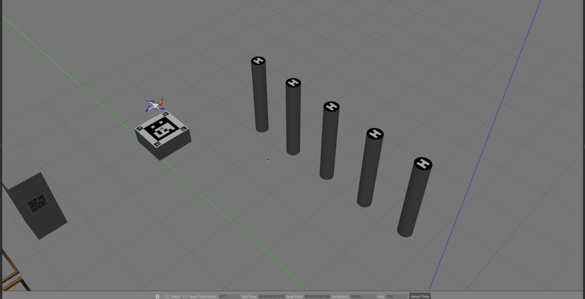

# UAV Waypoint Navigation and Vision-Assisted Landing

I built this simulation for the Hummingbird quadrotor in Gazebo. The quadrotor follows a predefined route and reads a QR code with its forward-facing camera. At a designated waypoint, it uses an ArUco marker viewed by its downward-facing camera to align with the landing platform, descend in steps, and climb to resume the route.

[](assets/demo.mp4)

[Watch or download the original simulation demo (92 seconds)](assets/demo.mp4)

## My Contributions

| Component | Implementation |
| --- | --- |
| Waypoint navigation | Configured 26 three-dimensional waypoints with target headings and dwell times. Interpolated position and yaw between waypoints and sent the setpoints to the RotorS position controller. |
| QR code reading | Connected the forward-facing camera's image topic to `zbar_ros` in the ROS launch file. The node publishes decoded text on `/barcode`. |
| Vision-assisted landing | Combined the ArUco pose estimate with vehicle odometry to compute horizontal position corrections. After alignment, the flight node lowers the target altitude in steps and then commands a climb. |
| Pattern detection | Used OpenCV template matching to detect a target pattern and published the detection result on `/detection_result`. |

## Demo Highlights

The recording shows the decoded QR text in the ROS terminal. In Gazebo, the quadrotor approaches the marked platform, descends, then climbs to continue along the waypoint route.

## Running the Original Simulation

The original environment uses Ubuntu 20.04, ROS Noetic, and Gazebo. The commands below use the original, prebuilt `catkin_ws` workspace containing RotorS and the project nodes. QR code reading and ArUco detection require `ros-noetic-zbar-ros` and `ros-noetic-aruco-ros`, respectively. This portfolio repository contains the project overview, screenshot, and demo video.

```bash
source /opt/ros/noetic/setup.bash &&
source ~/catkin_ws/devel/setup.bash &&
roslaunch rotors_gazebo qr_detect.launch mav_name:=hummingbird
```

`qr_detect.launch` loads the `scut_uav` world and starts Gazebo in a paused state. To see decoded QR text, run the following command in a second terminal before pressing **Play** in Gazebo.

```bash
source /opt/ros/noetic/setup.bash && rostopic echo /barcode
```

## Tech Stack and Credits

C++ · ROS Noetic · Gazebo · Eigen · OpenCV · `aruco_ros` · `zbar_ros`

RotorS from ETH Zurich's Autonomous Systems Lab provides the Hummingbird model, Gazebo plugins, and position controller. The `zbar_ros` package provides QR decoding. [RotorS source](https://github.com/ethz-asl/rotors_simulator) · [zbar_ros package](https://index.ros.org/p/zbar_ros/#noetic)
